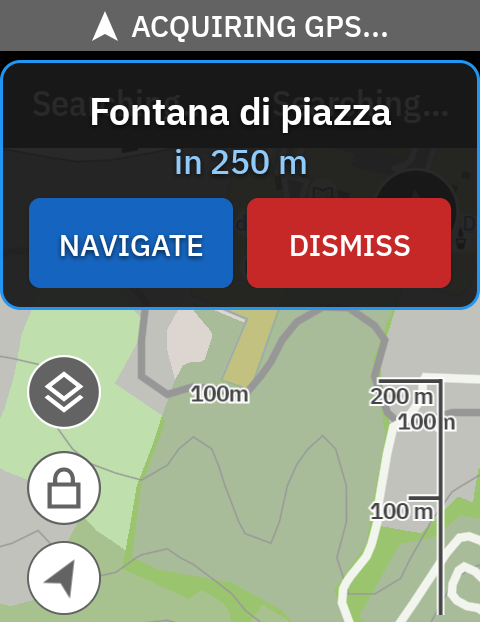
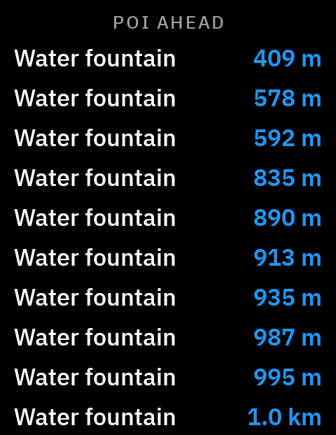
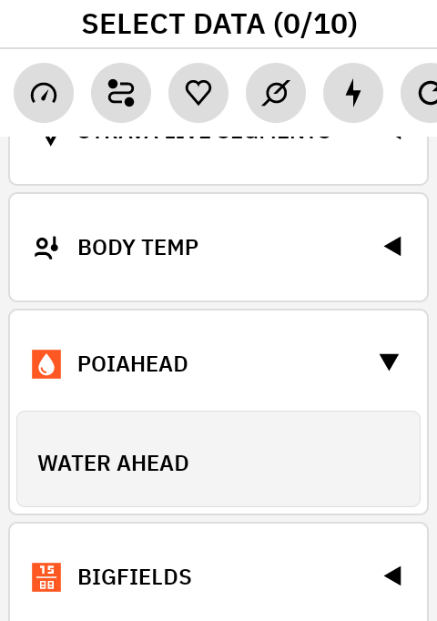
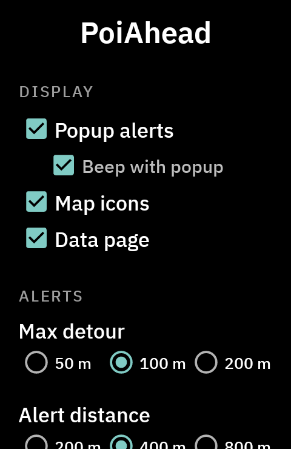

# PoiAhead

> **Version 1.0** — install the APK from the [latest release](../../releases/latest/download/PoiAhead.apk).

Drinking-water fountains from OpenStreetMap along your ride, on the Hammerhead Karoo. A popup tells you when a fountain is coming up and takes you there with one tap.

For now PoiAhead shows water only. The same machinery could later show other points of interest (public toilets, rest areas with tables and benches, …) wherever OpenStreetMap has the data.

## What it does

**The popup is the point.** While you ride, when a fountain is coming up within the alert distance and close enough to your route, a popup appears at the top of the screen, whatever page you are on, with a short double beep: the name of the fountain and the distance, with **NAVIGATE** and **DISMISS**. NAVIGATE hands the fountain to the Karoo's own pin navigation. The distance is live: it is recomputed at every GPS fix while the popup is on screen (25 s, about 170 m of road at 25 km/h), and once you are past the closest point it turns amber and says *moving away*. Without a tap the popup closes on its own.

**The data page** is a full-page field, *Water Ahead*, listing the ten fountains closest to you with their distance. It is worth a page mainly on very long rides, to see what is coming and get ready for the refills; on an ordinary ride the popup alone does the job.

**Map icons**: the fountains from OpenStreetMap (the 50 closest within 10 km) are drawn on the Karoo map as water symbols, the same pin the Karoo uses for the water points of a route; the fountains that the route itself carries are drawn by the Karoo anyway. Together with the popup off, this is the "show me, don't tell me" mode.

Each of the three can be switched off in the app.

## When the popup fires

- The fountain is within the **alert distance** (200, 400 or 800 m, default 400).
- With a route loaded and you on it, the fountain is within the **max detour** from the route line (50, 100 or 200 m, default 100). Without a route, or off route, the straight-line distance from you must be within the max detour instead: only fountains you are really passing by.
- Only while the ride is recording, and not during the **quiet start** (the first 2, 5, 10, 20, 30 or 40 km, default 5: you leave with full bottles, and where fountains are everywhere you may only want to hear about them late in the ride).
- One popup every two minutes at most; the same fountain can alert again after 30 minutes, so on an out-and-back it is still there on the way home.

Distances are straight-line. A fountain just behind you is as "close" as one ahead; the along-the-route version is being measured on real rides (see the technical notes) and will replace it when the numbers hold up.

## Where the fountains come from

- **OpenStreetMap**, nodes tagged `amenity=drinking_water`, fetched from the Overpass API and cached on the device for 30 days. Three areas are covered: a radius around the **Home** POI of your Karoo account (10, 25 or 50 km, default 25), downloaded on its own as soon as there is a connection; a 1 km corridor around the route when you load one; 5 km around your position, checked every 10 minutes while riding. For a trip far from home, load the route and press **Download POIs for current route** before leaving.
- **The route's own POIs** (the water points you placed on Komoot, for example) and the water POIs saved on your Karoo account. They are already drawn on the map by the Karoo; PoiAhead only adds them to the popup and to the page.

The network is used for the Overpass download only: the Karoo's Wi‑Fi, or the phone through the companion app, which is enough to cover a new area during a ride. Nothing else leaves the device.

## Install

1. Download [`PoiAhead.apk`](../../releases/latest/download/PoiAhead.apk) from the latest release.
2. Sideload it onto the Karoo, for example with `adb install -r PoiAhead.apk`, or copy it to the device and open it there.
3. Open **PoiAhead** from the app list and grant the **overlay permission** when asked: the popup is a window drawn over the ride screen and the Karoo does not allow it by default. **TEST POPUP** shows a sample popup three seconds later, time enough to go back to the ride screen and see it where it will really appear.
4. With the Karoo on Wi‑Fi, the status at the bottom of the app shows the Home area downloaded and the number of cached fountains.
5. Optionally, in the Karoo profile editor, add a data page with the single field *Water Ahead* from the PoiAhead extension.

It is not on the Hammerhead app store, but once installed it appears in the Karoo **Extensions** library with its description, screenshots and version, and the Karoo checks there for a newer release. The APK is release-signed: new versions install over the old one with the same command, settings and cache are kept.

## Settings

- **Popup alerts**, **Beep with popup**, **Map icons**, **Data page**: the three surfaces, independent.
- **Max detour**, **Alert distance**, **No alerts for the first…**: the rules above.
- **Home radius**: the area around the Home POI kept in the cache.
- **Download POIs for current route**: manual download of the corridor of the loaded route.
- **Status**: overlay permission, cached fountains, last position, active route, and the test popup.

## Technical notes

- **Popup.** An Android overlay window (`TYPE_APPLICATION_OVERLAY`, not focusable: touches outside it go to the ride app) in the upper part of the screen, since the Karoo draws its turn banner over the bottom. Without the overlay permission the alert falls back to the Karoo's native in-ride alert, informative only, no NAVIGATE.
- **Data page.** The engine recomputes every 5 s, but the page redraws only when a displayed line changes and only while it is the page on screen (on e-ink every redraw costs battery and leaves ghosting). If the active page is unknown the page draws anyway: a gate that filtered it out by mistake would freeze it for a whole ride and fail silently.
- **Ahead along the route, in the shadow.** Every fountain is projected onto the route (one entry per pass, so an out-and-back yields two) and the rider's position along the route comes from the Karoo (`routeDistance − DISTANCE_TO_DESTINATION`, invalid while off route or rejoining). This criterion runs on every tick but fires nothing: its decision is logged next to the real one, and it is promoted only after enough rides with a route show that the Karoo position is reliable and that the alerts it classifies as *behind* were indeed false positives.
- **Network.** Overpass is reached through the Karoo's own HTTP channel first (Wi‑Fi, or the companion app over Bluetooth), plain HTTP as fallback. The SDK channel caps responses at 100 KB, so an area is fetched as tiles of about 0.1°. Overpass is a public, shared service: a `504` from it is normal at busy hours, the cache fills on the next try.
- **Logs.** `Android/data/com.anpaiss.poiahead/files/poi_ahead.log` (1 MB, one `.old` generation): version, route, GPS, downloads, every alert decision with its reason, popups. Next to it `poi_ahead_samples.csv`, one row per 5 s tick while recording (4 MB rotation): what PoiAhead saw and decided, what the along-route criterion would have decided, and what the Karoo says about the position on the route. Numbers always use a dot as decimal separator.
- **Tested on** a Karoo 3 (Android 12, 480 × 800 px). The Karoo 2 is supported by the SDK but untested.
- **Build.** Every push runs the unit tests and builds a debug APK; a tag `vX.Y` builds the signed release APK and attaches it, with the Karoo extension manifest (`app/manifest.json`, generated at build time), to a GitHub release. Secrets: `KEYSTORE_BASE64`, `KEYSTORE_PASSWORD`, `KEY_ALIAS`, `KEY_PASSWORD`; `karoo-ext` comes from GitHub Packages (`GITHUB_TOKEN`, or `GPR_TOKEN`; locally `gpr.user` / `gpr.key` in `local.properties`).

## Known limitations

- Distances are straight-line, in the popup and on the page; a fountain behind you can still alert.
- Many fountains have no name in OpenStreetMap and show as *Water fountain*.
- The cache needs a connection once per area; without it the page says so and nothing alerts.

## Feedback

Bug reports and ideas are welcome as [issues](../../issues). Please include the Karoo model, the Karoo OS version and, if you can, the log file.

## Data

Water source data © [OpenStreetMap](https://www.openstreetmap.org/copyright) contributors, via the Overpass API (ODbL).

## License

MIT, see [LICENSE](LICENSE).
